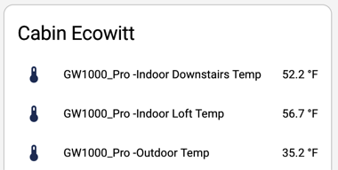
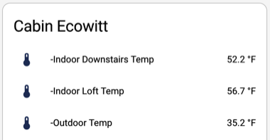
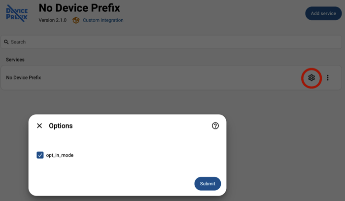
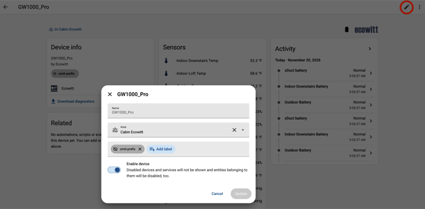

# No Device Prefix (Home Assistant `2026.11+`)

A lightweight frontend patch for Home Assistant **restoring shorter dashboard card row names**, displaying switches and sensor names as they appeared in `2026.10.4` and prior versions.

This custom integration alters the entity display naming behavior introduced in `2026.11.0` (which now prepends the device name to the entity name) by stripping back out the prepended device names from the entity labels on dashboards, entity pickers, and More Info dialogs. (I.e., it **reverses** the new default naming behavior; which was itself *a reversal of the old default naming behavior*).

It works well on **both** auto-generated dashboards/dashboard cards and on custom dashboard cards without an overriding `name:` field in the YAML for a particular sensor or switch entity. It primarily operates on those two types of dashboards; it has minimal effect on post `2026.2` Home Dashboard templates (although it does fix the Favorites row). Home Dashboard appears unaffected by this hotfix, but it I have not yet tested it extensively against those templates.

Version 2.1 adds **per-device** and **Opt-Out** / **Opt-In** controls. As it is currently a non-standard custom integration, it defaults to **Opt-Out mode**—all entities with their own sub-name have their prepended device name stripped automatically. **This keep-or-omit behavior can be changed per device or globally.** *(Note: If Home Assistant developers ever consider integrating something like this into the HA Front End, it would likely need to be an Opt-In feature.)*

---

## Why This Exists and What This Fixes (Illustrated)

Home Assistant `2026.11.0` removed automatic prefix stripping in device entity display contexts, causing long, truncated labels on multisensor devices:
* **The new `2026.11` behavior:** `GW1000_Pro Indoor Temperatur...`, `GW1000_Pro Indoor Humidity`
* **After No Device Prefix installed (the old behavior):** `Indoor Temperature`, `Indoor Humidity`

| Before (`2026.11` Default) | After (`No Device Prefix`) |
| :---: | :---: |
|  |  |

---

## Installation

1. **Marketplace / HACS (Recommended):**
   * Open **Settings > Marketplace** (or **HACS**), click the **three dots (`...`)** in the top-right corner > **Custom repositories**, and add `https://github.com/tcrgit/ha-no-device-prefix` as an **Integration**.
   * Install **No Device Prefix** and click **Setup** (or restart Home Assistant and add it via **Settings > Devices & Services > + Add Integration** on `2026.10` and older).
2. **Manual:**
   * Copy `custom_components/no_device_prefix` into your `/config/custom_components/` directory and **Restart Home Assistant**.
   * Go to **Settings > Devices & Services > + Add Integration**, search for **No Device Prefix**, and submit.
3. **Clear your frontend cache** (see [Clearing Frontend Cache](#clearing-frontend-cache) below).

---

## Usage & Controls

Upon installation, the integration automatically creates two device labels under **Settings > Areas, labels & zones > Labels**: **`keep-prefix`** and **`omit-prefix`**.

### 1. Switching Global Modes (Opt-Out vs. Opt-In)
1. Go to **Settings > Devices & Services** and select the **No Device Prefix** integration.
2. Click the **gear icon (`⚙️`)** (or **Configure**).
3. Toggle **"Opt-In mode only"**:
   * **Unchecked — Opt-Out Mode (Default):** Strips prefixes automatically on all entities that have their own sub-name. Use **`keep-prefix`** on any device whose full name should be preserved. This reverses the new naming behavior system-wide and allows you to keep the prefix prepending on a per device basis.
   * **Checked — Opt-In Mode:** Leaves all names in the post-`2026.11` display format by default. Use **`omit-prefix`** only on the multi-sensor (or other) devices you want to restore to their shortened display in the dashboard. This **keeps** the new naming behavior system-wide and allows you to omit the prefix prepending on a per device basis.
4. Refresh any open dashboard tabs (`Ctrl + R` or `Cmd + R`) to apply the new mode.



### 2. Applying Labels to Specific Devices
1. Go to **Settings > Devices & Services > Devices** and open the **device** you want to configure.
2. Click the **pencil icon (`✎`)** in the top-right corner of the device page.
3. Click into the **Labels** dropdown and select **`keep-prefix`** or **`omit-prefix`**, then click **Update**.
4. Refresh your dashboard tab (`Ctrl + R` or `Cmd + R`) to see the updated labels.

*Note: Adding the `keep-prefix` or `omit-prefix` label to the entity (i.e. the switch or sensor) does nothing. The label must be attached to the **device**.*



*(Tip: If you prefer more descriptive labels or the automatically generated ones do not appear, you can create or use any of the following patterns: `Keep Prefix`, `keep-prefix`, `keep-device-prefix`, `Omit Prefix`, `omit-prefix`, `omit-device-prefix`, `no-prefix`, and `no-device-prefix` all work interchangeably. The custom integration's label matching function ignores case, spaces, hyphens, and underscores).*

---

## Clearing Frontend Cache

Whenever you first install the integration or update to a new version, clear your client cache so the new JavaScript module loads:
* **Desktop Browser:** Hard-refresh the page (`Ctrl + Shift + R` on Windows/Linux, `Cmd + Shift + R` on Mac).
* **iOS / Android Companion App:** Go to **Settings > Companion App > Debugging > Reset frontend cache**, then force-close and reopen the app.

---

## How It Works

* **Presentation-Layer Only:** Intercepts `hass.entities` and `hass.states` in the browser and Companion App; underlying `entity_id` strings, the SQLite history, and automations remain untouched.
* **Primary-Entity Guard:** Primary or standalone entities whose name *is* the device itself (where the entity has no separate sub-name) retain their device name to prevent generic labels like `Switch` or `Light`.
* **Custom Entity Names Preserved:** Entities you have explicitly renamed in the GUI keep their custom names as-is-unless the custom name literally starts with the device name, in which case that redundant prefix is still stripped.
* **Github tracking Indices:** This reverses the HA github issue that was marked as resolved and was incorporated into `the 2026.11.0` release in [`frontend#54727`] (https://github.com/home-assistant/frontend/pull/54727). (See also the curt **we-intended-to-do-this-to-your-dashboard-names** response closing `frontend#55664`).

---

## Caveats & Troubleshooting

* **External APIs & InfluxDB:** Because this patch runs in the browser, backend `friendly_name` attributes remain visible to HomeKit, Alexa, Google Assistant, and external InfluxDB integrations (`tags_attributes: friendly_name`). Home Assistant's built-in SQLite Recorder indexes by `entity_id` and is completely unaffected.
* **Troubleshooting:** Open your browser's Developer Tools (`F12` or `Cmd + Option + I`) and check the Console for:
  ```text
  [No Device Prefix] Active (v2.1.0, mode=opt-out).
  ```
